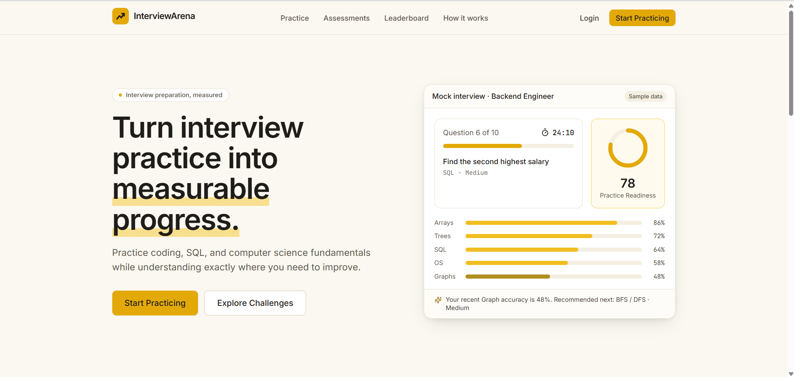
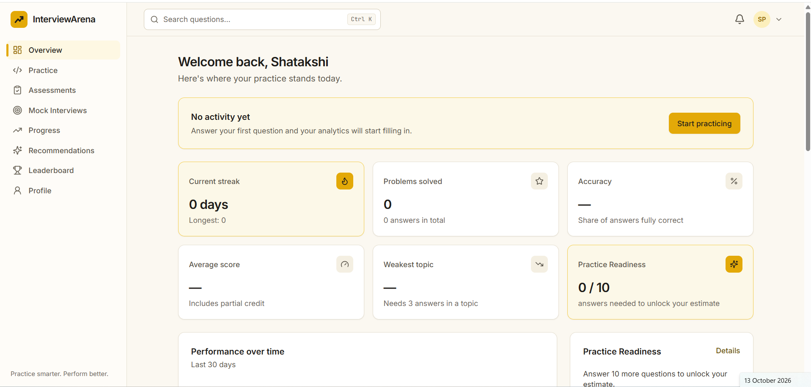
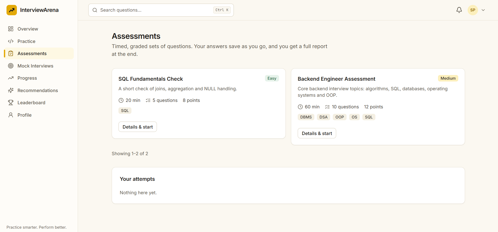
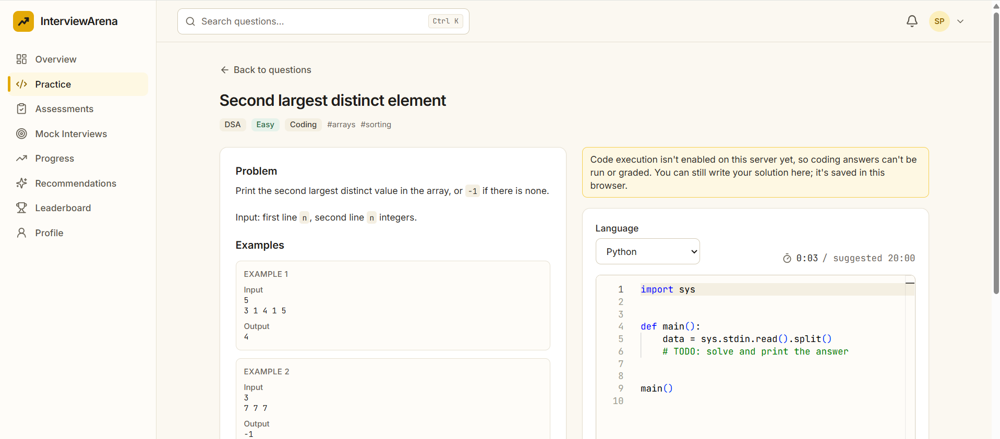
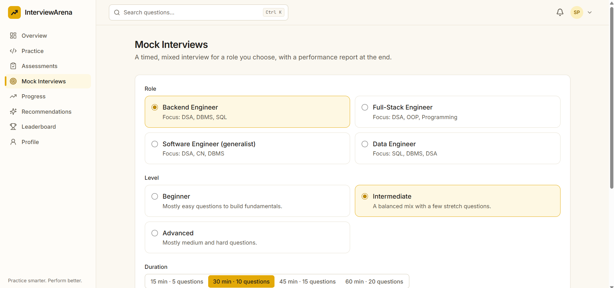
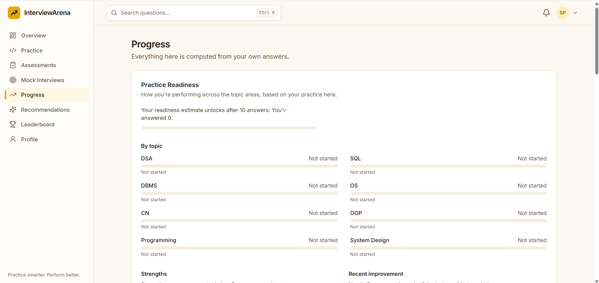
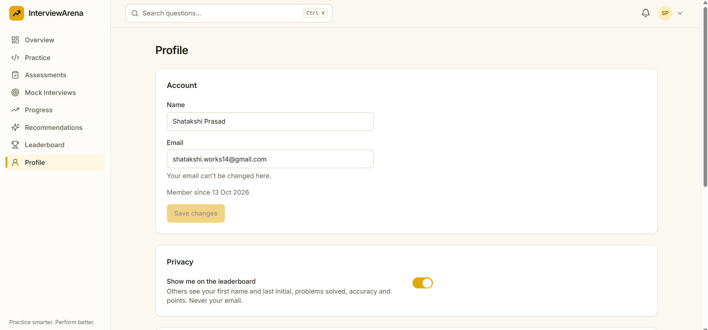

# InterviewArena — Practice Smarter. Perform Better.

**A full-stack interview preparation platform to practice technical concepts, assess readiness, identify weak areas, and prepare smarter for technical interviews.**

<p align="center">
  <a href="https://interview-arena-ashy.vercel.app/">
    
  </a>
  
</p>

<p align="center">
  <b>React · TypeScript · FastAPI · Python · PostgreSQL · Machine Learning</b>
</p>

---

## 📌 Overview

InterviewArena is a full-stack platform designed to make technical interview preparation more structured and measurable.

It brings together technical practice, SQL exercises, coding interfaces, mock interview preparation, performance analytics, and machine-learning-based readiness scoring in one application.

The frontend is deployed, while external code execution, LLM-powered feedback, and further deployment validation remain in progress.

## 🌐 Live Application

**Try it here:** https://interview-arena-ashy.vercel.app/

> Note: Some functionality may be limited while backend connectivity and external integrations are being configured.

---

## 📸 Application Screenshots

Screenshots of the application are organized below. Replace the example filenames with your actual screenshots, and keep the images in the repository's `screenshots/` directory.

### 1. Home Page / Landing Page

The entry point to InterviewArena.

<p align="center">
  
</p>

### 2. Dashboard

An overview of the user's interview preparation activity and progress.

<p align="center">
  
</p>

### 3. Technical Practice — MCQs

Practice technical concepts through multiple-choice questions.

<p align="center">
  
</p>

### 4. SQL Practice

Practice database concepts and SQL query writing.

<p align="center">
  
</p>

### 5. Coding Practice

A coding interface for practicing Python and Java problems.

<p align="center">
  
</p>

### 6. Mock Interviews

Configure practice sessions based on role, difficulty, duration, and areas for improvement.

<p align="center">
  
</p>

### 7. Performance Analytics

Review preparation activity, performance trends, and weak topics.

<p align="center">
  
</p>

### 8. Interview Readiness

A machine-learning-based readiness score designed to guide preparation.

<p align="center">
  
</p>

### 9. Achievements and Leaderboard

Track practice streaks, achievements, and leaderboard progress.

<p align="center">
  
</p>

### 10. Admin Dashboard

An administrative interface for platform management.

<p align="center">
  
</p>

---

## ✨ Key Features

### Technical Preparation
- MCQ-based technical practice.
- SQL practice.
- Short-answer technical questions.
- Python and Java coding editor interface.

### Mock Interview Preparation
- Role-based practice sessions.
- Configurable difficulty and duration.
- Practice focused on weaker topics.

### Performance and Analytics
- Practice activity and performance tracking.
- Weak-topic identification.
- Progress-oriented dashboards.

### Machine Learning
- Logistic regression-based interview readiness scoring.
- Practice recommendations to guide further learning.
- Baseline readiness logic designed to operate independently of optional LLM services.

### Engagement and Administration
- Practice streaks and achievements.
- Leaderboard functionality.
- Administrative interface.

---

## 🛠️ Tech Stack

| Component | Technology |
|---|---|
| Frontend | React 19, TypeScript, Vite |
| Styling | Project-configured styling framework |
| Backend | Python, FastAPI |
| Validation | Pydantic |
| Database | PostgreSQL 16 |
| ORM | SQLAlchemy |
| Database migrations | Alembic |
| Code editor | Monaco Editor |
| Machine learning | Scikit-learn, Logistic Regression |
| Testing | Vitest |
| Deployment | Vercel |
| Containerization | Docker |

---

## 🏗️ Architecture

```text
                 USER
                   |
                   v
        React + TypeScript Frontend
                   |
                REST API
                   |
                   v
             FastAPI Backend
                   |
          +--------+--------+
          |        |        |
          v        v        v
       Services  Validation  ML Logic
          |
          v
      SQLAlchemy ORM
          |
          v
       PostgreSQL

    Optional Integrations
       /           \
      v             v
   Judge0         LLM API
 Code Execution  AI Feedback
```

The frontend manages the user interface and interactions. The backend handles API requests, validation, application logic, and database access. The machine-learning component supports readiness scoring, while external integrations are intended to extend coding and feedback functionality.

---

## 🚧 Development Status

| Component | Status |
|---|---|
| Frontend deployment | Deployed on Vercel |
| Practice interfaces | Implemented; end-to-end testing ongoing |
| Readiness scoring | Baseline ML component implemented |
| PostgreSQL persistence | Requires deployed-environment verification |
| Judge0 integration | API key and configuration pending |
| LLM-powered feedback | API key and configuration pending |
| End-to-end testing | Ongoing |
| Production hardening | Ongoing |

## 🗺️ Roadmap

- [ ] Configure and test Judge0 code execution.
- [ ] Integrate LLM-powered answer evaluation and feedback.
- [ ] Verify backend deployment and database persistence.
- [ ] Test authentication and authorization flows.
- [ ] Add comprehensive API and end-to-end tests.
- [ ] Improve loading states and error handling.
- [ ] Review security, environment variables, and deployment configuration.
- [ ] Expand documentation with API examples and additional screenshots.

---

## 💻 Run Locally

### Prerequisites

- Node.js and npm
- Python version supported by the backend dependencies
- PostgreSQL
- Git
- Docker (optional)

### 1. Clone the repository

```bash
git clone https://github.com/shatakshi-1404/interview-arena.git
cd interview-arena
```

### 2. Configure the backend

```bash
cd backend
python -m venv .venv
```

Activate the virtual environment on Windows:

```powershell
.venv\Scripts\Activate.ps1
```

Install the project's backend dependencies:

```bash
pip install -r requirements.txt
```

Configure your environment variables using the variable names defined in the backend configuration. Set up the PostgreSQL database before starting the application.

If the project uses Alembic migrations:

```bash
alembic upgrade head
```

Start the API using the actual application entry point. For example:

```bash
uvicorn main:app --reload
```

API documentation is typically available at `http://127.0.0.1:8000/docs` when enabled.

### 3. Start the frontend

Open a new terminal and navigate to the frontend directory:

```bash
npm install
npm run dev
```

Configure the frontend's API URL to point to the backend using the environment variable expected by the project.

> Check the repository's actual scripts, directory structure, and dependency files before running these commands.

---

## 🔐 Environment Variables

Keep credentials in environment variables and deployment secrets. Never commit API keys or expose private server-side credentials in frontend code.

The backend may require configuration for:

- Database connection.
- Authentication and security settings.
- Judge0 API access.
- LLM provider credentials.
- Frontend/backend allowed origins.

Use the exact variable names expected by the application.

---

## 🧠 What This Project Demonstrates

InterviewArena is a practical exercise in building and deploying an application that combines:

- Full-stack development using React and FastAPI.
- REST API integration and relational database design.
- ORM-based data access and backend validation.
- Machine learning integrated into a software product.
- Deployment, configuration, debugging, and testing.
- Integration planning for external coding and LLM services.

## 👩‍💻 Author

**Shatakshi Prasad**

B.Tech Computer Science and Engineering — AI/ML Specialization, VIT Bhopal University

- **GitHub:** https://github.com/shatakshi-1404
- **LinkedIn:** https://www.linkedin.com/in/shatakshi-prasad-9104772b8/
- **Live Project:** https://interview-arena-ashy.vercel.app/

---

<p align="center">
  <b>InterviewArena — Practice smarter. Perform better.</b>
</p>

*An actively developed portfolio project. Features, integrations, and deployment reliability continue to be tested and improved.*
